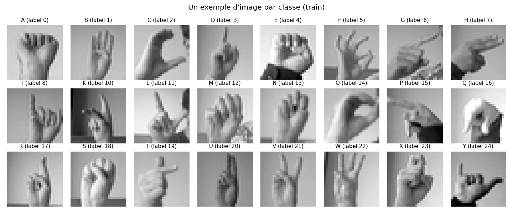
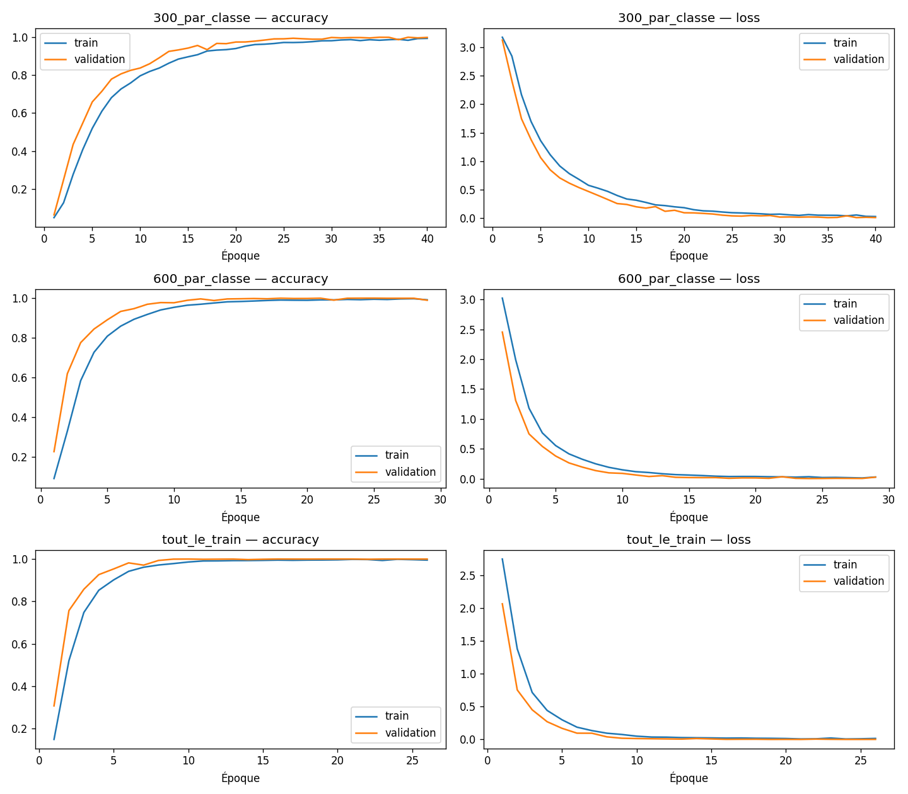
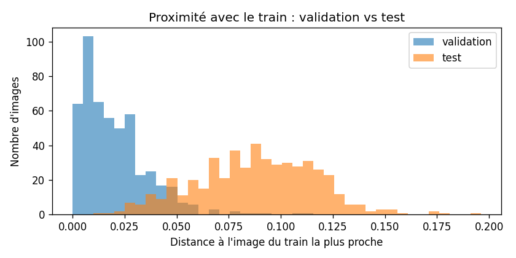
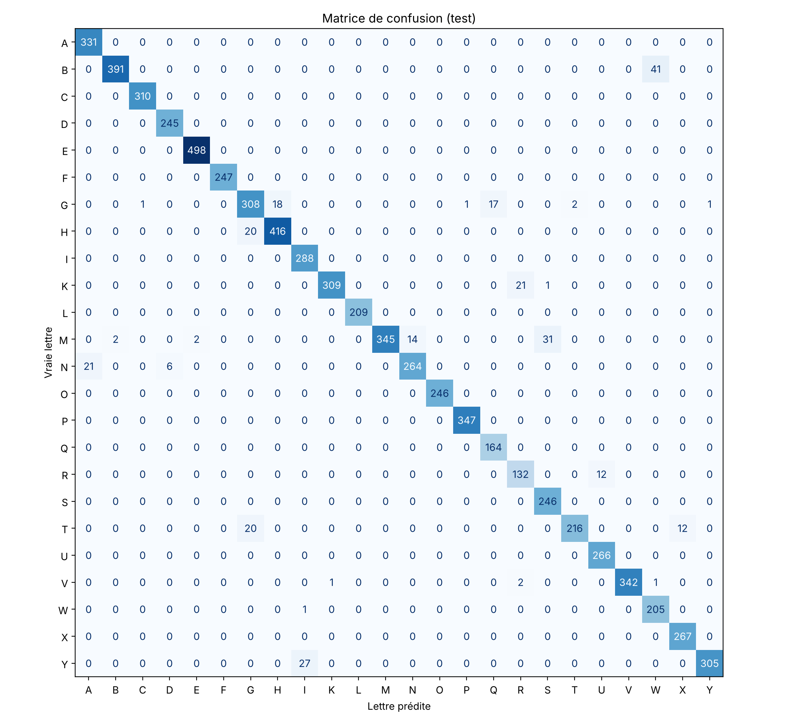
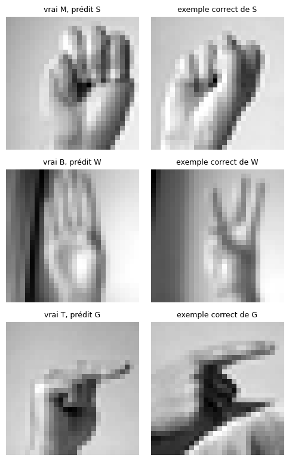

# American Sign Language (ASL) Image Classification with a CNN

*Classification d'images de la langue des signes américaine (ASL) à l'aide d'un CNN*

[Français](README.md) | **English**



[](https://colab.research.google.com/github/Laraki-Yacout/ASL_CNN_Project/blob/main/ASL_CNN_Classification.ipynb)

**BD2C Master's** project, course "Artificial Intelligence and Innovation".
A convolutional neural network trained to recognize the **24 static letters of the ASL alphabet** from 28 × 28 grayscale images.

> The notebook and its explanations are written in French.

---

## Goal

Given an image of a hand, predict the ASL letter it shows and display the probabilities of the 24 classes.

The system:

1. takes an image;
2. preprocesses it (grayscale, 28 × 28, normalization);
3. automatically extracts visual features with convolutional layers;
4. predicts the letter and displays the scores;
5. is evaluated on an independent test set.

> The project classifies **individual images**. It does not translate words or sentences of sign language.

## Dataset

**[Sign Language MNIST](https://www.kaggle.com/datasets/datamunge/sign-language-mnist)** (Kaggle, CC0 license)

| Property | Value checked in the notebook |
|---|---|
| Training images | 27,455 |
| Test images | 7,172 |
| Size | 28 × 28, grayscale (pixels 0–255) |
| Classes | 24 letters (A–Y without J; no Z) |
| Format | CSV: 1 `label` column + 784 pixel columns |
| Missing values | none |

J and Z are excluded because they require motion. The dataset was built from only **1,704 original photos**, each turned into many variants (cropping, filters, noise, brightness, rotation).

## Method

1. **Loading** with KaggleHub and file checks.
2. **Exploration**: class distribution, sample images, pixel distribution.
3. **Preprocessing**:
   - removal of exact duplicates within the training set and of training images identical to test images;
   - re-encoding of labels (0–24 without 9) into consecutive indices 0–23;
   - reshaping to 28 × 28 × 1 and scaling to [0, 1];
   - stratified train / validation split (80 / 20), official test set kept aside;
   - measurement of how close validation and test images are to the training set (leakage risk from variants of the same photo).
4. **CNN architecture** (112,280 parameters):

   ```
   Input 28×28×1
   → Conv2D 32 (3×3, ReLU) → MaxPooling 2×2
   → Conv2D 64 (3×3, ReLU) → MaxPooling 2×2
   → Conv2D 128 (3×3, ReLU) → MaxPooling 2×2
   → GlobalAveragePooling2D
   → Dense 128 (ReLU) → Dropout 0.3
   → Dense 24 (Softmax)
   ```

5. **Training**: Adam (lr = 0.001), `SparseCategoricalCrossentropy`, batch size 64, EarlyStopping on validation loss. Three training-set sizes compared on validation: 300 images/class, 600 images/class, full training set.
6. **Single evaluation on the test set**: accuracy, precision, recall, F1, confusion matrix, error analysis.
7. **Prediction on an external image** and **model saving** (`.keras`) with the class order.

## Results

Results of the run shown in the notebook (Google Colab, T4 GPU). A first run gave 96.17%: on GPU, results vary slightly from one run to another.

### Test performance (7,172 images, evaluated once)

| Metric | Value |
|---|---|
| **Accuracy** | **95.84%** |
| Macro F1 | 0.954 |
| Macro precision | 0.952 |
| Macro recall | 0.959 |
| Errors | 298 / 7,172 |

### Effect of training-set size (validation)

| Training data | Best epoch | Validation accuracy | Validation loss |
|---|---|---|---|
| 300 images / class | 39 | 99.96% | 0.0070 |
| 600 images / class | 37 | 100% | 0.0005 |
| Full training set (21,964) | 12 | 99.98% | 0.0047 |

Selected model (lowest validation loss): 600 images / class. With the full training set, the model converges in about a dozen epochs instead of nearly 40.



### Optimistic validation: a methodological point

Validation reaches 100% while the test set gives 95.84%. A nearest-neighbor distance measurement shows that validation images are **very close variants** of training images (same original photo): their median distance to the training set is 0.017, versus 0.089 for test images, i.e. 5 times larger. The test set, kept untouched until the end, is therefore the only reliable estimate.



### Confusion matrix



- C, F and O are recognized perfectly (F1 = 1.00).
- The hardest letters are R (F1 0.814), W (0.869) and T (0.901).
- **79% of errors** involve 10 pairs of visually similar signs: M→S (43), B→W (41), T→G (28), V→W (21), K→R (21), R→U (19), N→D (17)…



## Limitations

- The images are very homogeneous (cropped hand, 28 × 28, few people and backgrounds): performance does not guarantee reliable recognition on real-world photos.
- The dataset comes from only 1,704 photos; variants of the same photo can end up in both training and validation sets, which can make validation optimistic.
- J and Z (motion letters), words and sentences are not covered.

## Future work

- Data augmentation (rotations, shifts, brightness) to improve generalization.
- Testing on real photos or another ASL dataset.
- Higher resolution to capture fine details (thumb position).
- Explainability (Grad-CAM) to check that the model looks at the hand and not the background.

## Repository structure

```
ASL_CNN_Project/
├── ASL_CNN_Classification.ipynb   # full notebook (Colab, in French)
├── README.md                       # overview (French)
├── README.en.md                    # overview (English)
├── references.md                   # sources
├── model/                          # trained model (.keras) + classes.json
└── results/                        # charts and metrics
```

## Try the model on your own photo

No retraining needed: open a blank notebook on [Google Colab](https://colab.research.google.com/), paste this code into a cell and run it. A dialog lets you pick one or more photos.

```python
!wget -q https://github.com/Laraki-Yacout/ASL_CNN_Project/raw/main/model/asl_cnn.keras
!wget -q https://github.com/Laraki-Yacout/ASL_CNN_Project/raw/main/model/classes.json

import json, numpy as np, keras
from PIL import Image, ImageOps
from google.colab import files

model = keras.models.load_model("asl_cnn.keras")
classes = json.load(open("classes.json"))["class_names"]

for name in files.upload():
    img = ImageOps.exif_transpose(Image.open(name)).convert("L")
    w, h = img.size; s = min(w, h)
    img = img.crop(((w - s) // 2, (h - s) // 2, (w - s) // 2 + s, (h - s) // 2 + s)).resize((28, 28))
    x = np.asarray(img, dtype="float32").reshape(1, 28, 28, 1) / 255
    p = model.predict(x, verbose=0)[0]
    top = np.argsort(p)[::-1][:3]
    print(name, "->", ", ".join(f"{classes[i]} ({p[i]:.0%})" for i in top))
```

Tips: hand alone in the center of the photo, plain background, good lighting. The model was trained on very homogeneous images; a photo taken in other conditions may be misclassified.

## Full run

The trained model is provided in `model/`. It comes from the first run of the notebook (test accuracy 96.17%, trained on the full training set). Load it with `keras.models.load_model("model/asl_cnn.keras")` and the class order with `model/classes.json`.

To rerun everything:

1. Click the **Open in Colab** badge above.
2. **Runtime → Change runtime type → T4 GPU**.
3. **Runtime → Run all**.

## Technologies

Python · TensorFlow 2.21 · Keras 3 · NumPy · Pandas · scikit-learn · Matplotlib · Google Colab

## Authors

Team project carried out as part of the BD2C Master's program.
